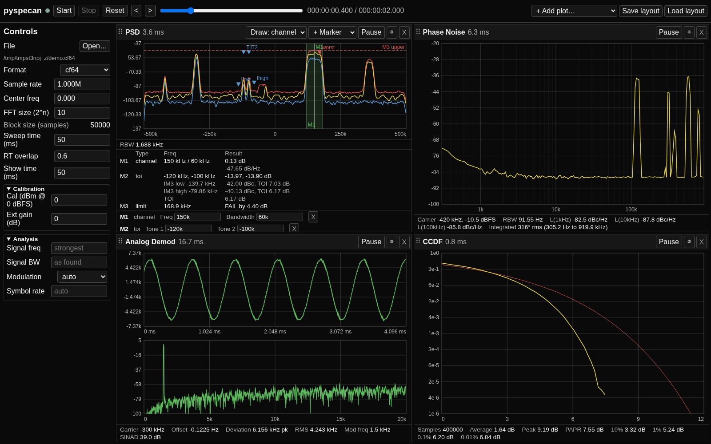
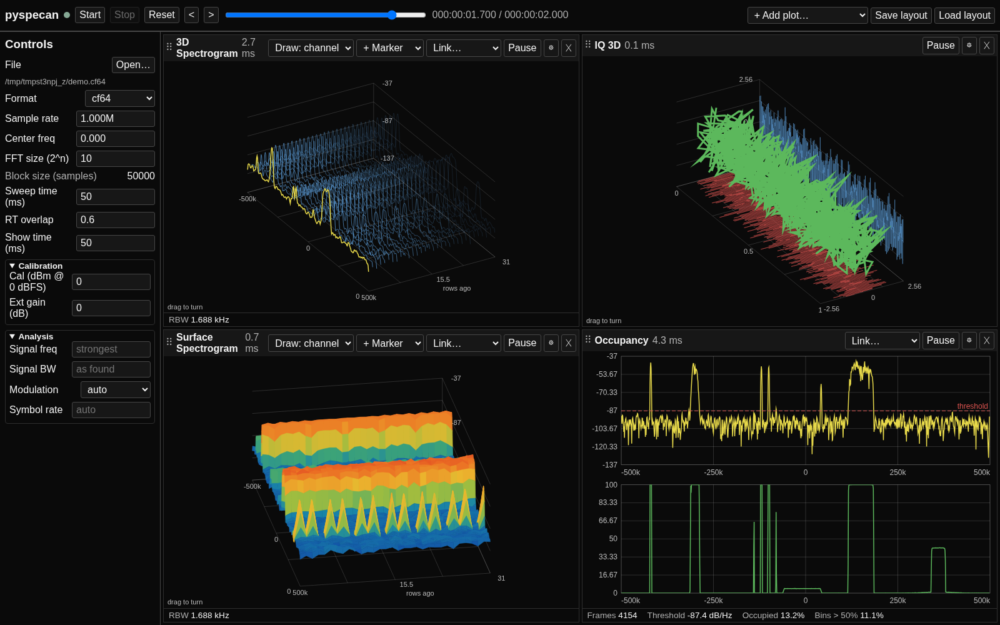
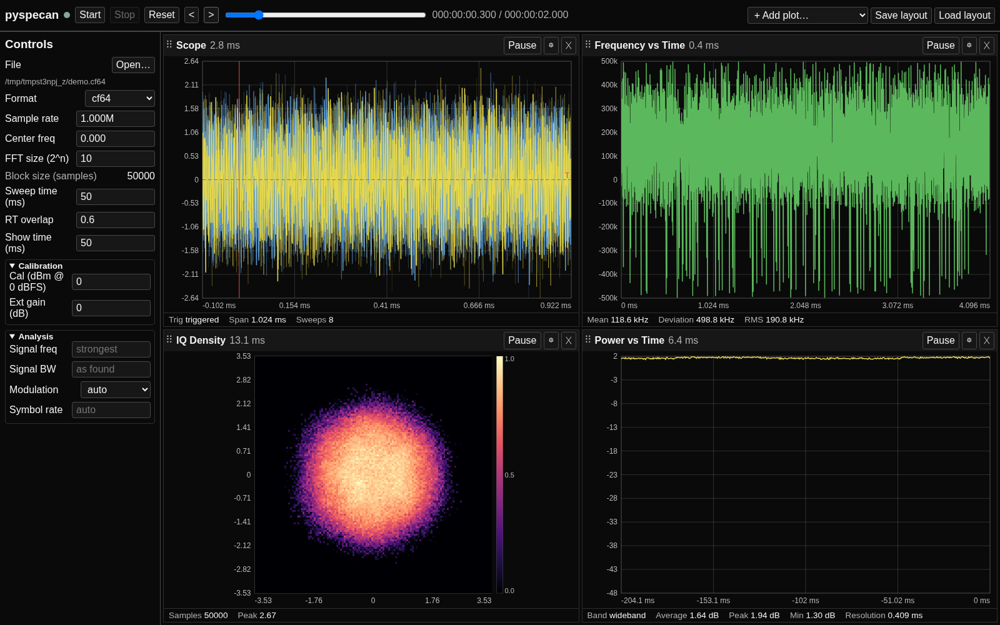
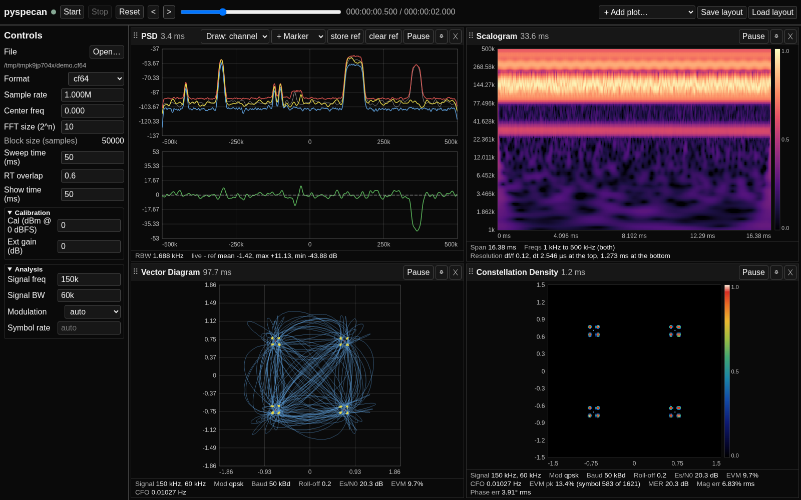
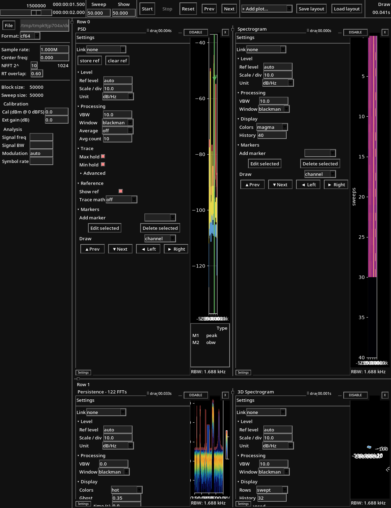
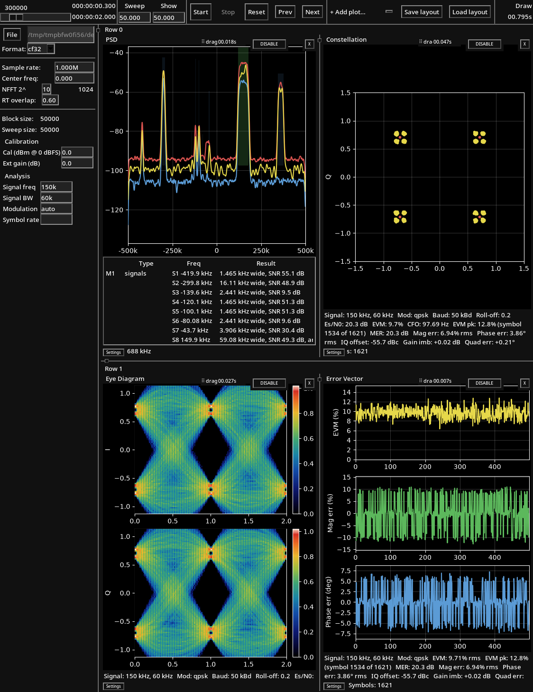
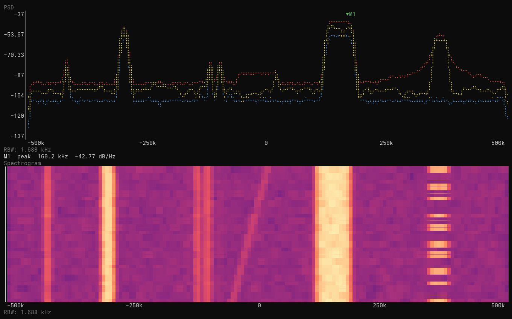

# pyspecan
 A spectrum analyzer library

 - [Documentation](https://anonoei.github.io/pyspecan/)
 - [PyPI](https://pypi.org/project/pyspecan/)


# Examples
Taken by `python dev/screenshots.py` on a synthetic capture (QPSK with an echo, an FM carrier, a carrier with phase
noise, two tones and their IM3 products, a bursty signal, a chirp); run it again to refresh them.

Web: PSD with found signals and a peak marker (the cursor readout over it), spectrogram, persistence, surface spectrogram


Web: channel power, TOI and a limit line, phase noise, FM demodulation, CCDF


Web: 3D waterfall, IQ 3D, a turned surface spectrogram, occupancy


Web: scope, frequency vs time, IQ density, power vs time


Web, with RPPS: the analysed signal's constellation, eye diagram and the link's response (network analyzer)


Web, with RPPS: 3D constellation, error vector, impulse response (the echo at 100 µs), cyclic spectrum


Web: a PSD against a stored reference (trace math: live - ref, the burst that has since stopped shows as a dip),
wavelet scalogram, and with RPPS the vector diagram and constellation density (the echo splits each point in four)


tkGUI: PSD with peak and occupied bandwidth markers, spectrogram, persistence, 3D waterfall


tkGUI, with RPPS: found signals, constellation, eye diagram, error vector


Console: PSD and spectrogram drawn as text


# Usage
- View (-v|--view): specifies which frontend to use (tk, web, cui; any case)
- Sink (-s|--sink): specifies which interface to use (file, live, tcpiq)
  - Live uses [pysdrlib](https://github.com/anonoei/pysdrlib) for hardware SDR abstractions
    - `-d` picks the radio: a driver (`uhd`), or a radio on a pysdrlib server (`tcp://host:5555/hackrf-0`). With no `-d` it uses the first radio attached to this machine
    - `--servers tcp://a:5555,tcp://b:5555` (or the `PYSPECAN_SERVERS` environment variable) names known servers. With no `-d` and no radio attached here, it uses the first server that has one. `--list` and the radio picker show their radios too
    - `--list` prints every radio it can use, with the options that pick each one
  - TCPIQ takes `--tcp_host`, `--tcp_port`, `--tcp_listen`, `--tcp_timeout`

## Module
- `python3 -m pyspecan --help`
- tkGUI, file: `python3 -m pyspecan`
- tkGUI, live (hackrf): `python3 -m pyspecan -s live -d hackrf`
- web, file: `python3 -m pyspecan -v web -f <file> -F cf64 -fs 250k`, then open http://127.0.0.1:8000
- console, file: `python3 -m pyspecan -v cui -f <file> -F cf64 -fs 250k`, type `help` (draws plots as text, needs no plotting library)

## Layouts
Start with specific plots, in rows, with their settings, links and markers. `--plot` adds a plot to the
current row, `--row` starts a new one. A plot is its name (case and spaces don't matter) then `key=value`
settings; `link=<name>` links plots that share a name, `marker=<kind>[:key=value,...]` adds a marker.
```
python3 -m pyspecan -v web -f <file> -F cf64 -fs 250k --cal_db -10 \
    --plot "PSD vbw=5 unit=dBm link=a marker=peak" --plot "spectrogram link=a" \
    --row --plot "persistence show_max=on" --plot "scope trig_mode=roll time_div=10u"
```
Every view can save its current layout (web and tkGUI: "Save layout", console: `save <file>`) as json, and
load one back ("Load layout", `load <file>`). Launch with it using `--layout <file>`:
```json
{"globals": {"cal_db": -10},
 "rows": [
   [{"type": "PSD", "link": "a", "settings": {"vbw": 5}, "markers": [{"kind": "peak"}]},
    {"type": "Spectrogram", "link": "a"}],
   [{"type": "Persistence", "settings": {"show_max": true}}]]}
```
Settings left out keep their defaults. Linked plots take the first one's shared (level, processing) values.

## Plots and measurements
Every view lists the plots it can draw (the web view and tkGUI draw them all, 3D included: drag a 3D plot to turn it,
double click to reset it; the console draws all but 3D).
- Spectrum: PSD (max / min hold, averaging, detector, a stored reference trace and trace math: "store ref" and the
  `math` setting, live - ref on its own axis), Spectrogram, RT Spectrogram, 3D Spectrogram (a waterfall of
  lines), Surface Spectrogram (a 3D surface spectrogram: the spectrogram as a solid surface colored by level), Persistence, FFT
- Time domain: IQ, IQ 3D, PMF, Phasor, IQ Density, Scope (triggered / roll), Frequency vs Time, Scalogram (a wavelet
  transform: frequency on a log axis against time, sharp in time at high frequencies, in frequency at low ones)
- Measurements: CCDF, Power vs Time, Occupancy, Phase Noise (L(f) on a log offset axis, integrated phase noise and
  jitter), Analog Demod (`mode` AM / FM / PM against time and its spectrum, depth / deviation, modulating frequency, SINAD)
- Markers on any spectrum (`+ Marker`, or `marker=<kind>` in a layout): point, peak (lands on the highest peak and
  stays there; its ▲ prev / ▼ next buttons step up / down the peaks by level, ◀ left / ▶ right to the nearest peak in
  frequency, the console's `marker <id> act <marker> next`; `track` follows the peak instead; a threshold line to drag),
  delta, peaks (peak table), channel power, ACPR, OBW (and -x dB bandwidth), harmonics (dBc and THD), TOI (third order
  intercept from two tones), limit (a line to drag, pass / fail with the margin), and with RPPS signals (below)

## Scope
The "Scope" plot is an oscilloscope: samples against time, with a trigger (auto, normal, single) and up
to `overlay` triggered sweeps from each block drawn together. `roll` mode is an untriggered strip chart
that shows every sample as a min/max envelope.
- `--plot "scope time_div=10u trig_mode=roll trig_level=0.2"` sets its initial values
- Screens longer than one block are filled across blocks
- For faster updates, lower the samples per block and the frame interval together, e.g. `-st 20 --show 20` (about 50 updates/s). Faster than the screen can redraw only adds lag.

## DSP plots (optional)
With [RPPS](https://github.com/Anonoei/RPPS) installed (`pip install pyspecan[dsp]`), pyspecan finds and analyses signals.
Without it everything else works the same, and these plots are not listed.
- The `signals` marker (any spectrum: PSD, spectrograms, persistence, 3D spectrogram) boxes every signal found in the
  block, with its width, SNR and duty cycle in the marker table. The analysed one is green: click a box to analyse that
  signal, drag a box's edges to adjust it
- "Constellation": the analysed signal's symbols after timing, carrier and gain recovery, over the ideal points, with
  modulation, symbol rate, roll-off, Es/N0, EVM and carrier offset
- "Eye Diagram": its matched filter output over two symbols, I and Q
- "Network Analyzer": the link's frequency response across the signal (magnitude, phase, group delay), measured blind
  from the decided symbols, no stimulus needed; "Impulse Response": the same inverse transformed, echoes by delay and level
- "3D Constellation": I and Q against time, the symbols on the matched filter's path; "Vector Diagram": the
  constellation with the path between the symbols; "Constellation Density": the symbols as a heat map
- "Error Vector": EVM, magnitude and phase error per symbol, with the error summary (peak EVM, MER, IQ offset, gain
  imbalance, quadrature error); "Error Vector Spectrum": where in the band the errors are
- "Cyclic Spectrum": the spectral correlation against cycle frequency and the spectral coherence image, with the symbol
  rate and carrier symmetry found blind (no lock needed)
- "Symbol Table": the decided symbols
- The "Analysis" globals (`--dsp_freq`, `--dsp_bw`, `--dsp_mod`, `--dsp_baud`) pick the signal and, when known, its
  modulation and symbol rate. Blank picks the strongest signal and finds the rest
```
python3 -m pyspecan -v web -f <file> -F cf64 -fs 1M \
    --plot "PSD marker=signals" --plot constellation --row --plot "eye diagram" --plot "network analyzer"
```

## Plot extensions
Other packages can add plots and marker kinds, which every view then lists. Name a module that
registers them (`@plot("Name")`, `@marker_kind("name")`) under the `pyspecan.plots` entry point group:
```toml
[project.entry-points."pyspecan.plots"]
mypkg = "mypkg.specan_plots"
```
See the `pyspecan.plots` docstring for a full example. `PYSPECAN_NO_EXTENSIONS=1` turns them off.

## Profiling
`python dev/profile_plots.py` times every plot alone on a synthetic capture and gives its cost in PSDs (a PSD on the
same blocks is 1.0), its median / p90 / first block in ms, and its share of real time (over 100% it can not keep up
with live samples at that rate on its own). `--markers` adds what each marker kind costs on a PSD, `--nfft`,
`--sweep` (block length, ms), `--plots`, `--set "Scope trig_mode=roll"` change what is timed, `--json` keeps the
numbers to compare runs. In a layout plots share the FFT frames and the DSP plots one signal search, so together
they cost less than the sum.

# Install
1. Run `pip install pyspecan`, to install (`pyspecan[tk]`, `[web]`, `[dsp]` for the views and the DSP plots)
2. Run `python3 -m pyspecan --help` to view available arguments

# Contributing
1. `git clone https://github.com/Anonoei/pyspecan`
2. `cd pyspecan`
3. `git branch -c feature/<your feature>`
4. `python3 builder.py -b -l` build and install locally

## Build executable
1. `pyinstaller src/pyspecan.spec`
2. `./dist/pyspecan`
