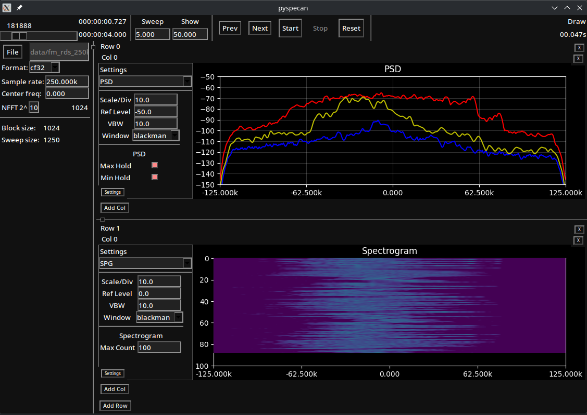
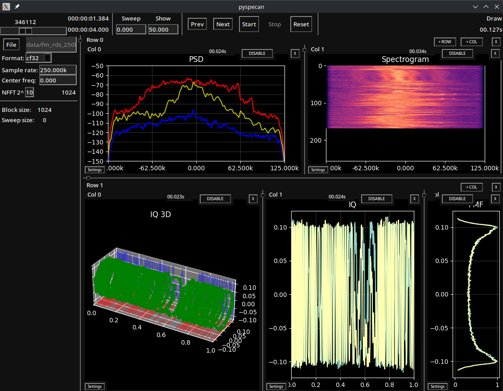
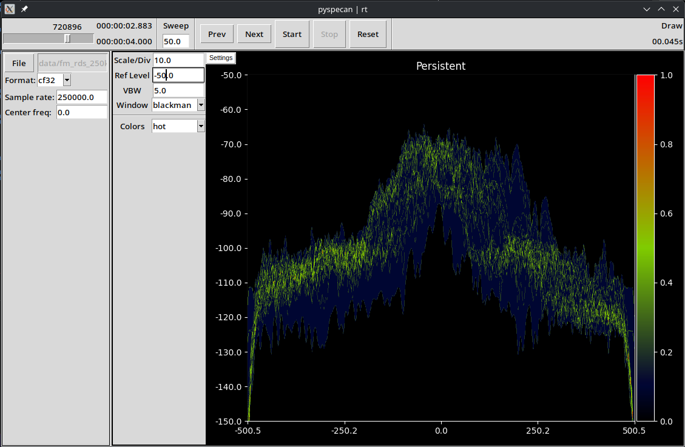
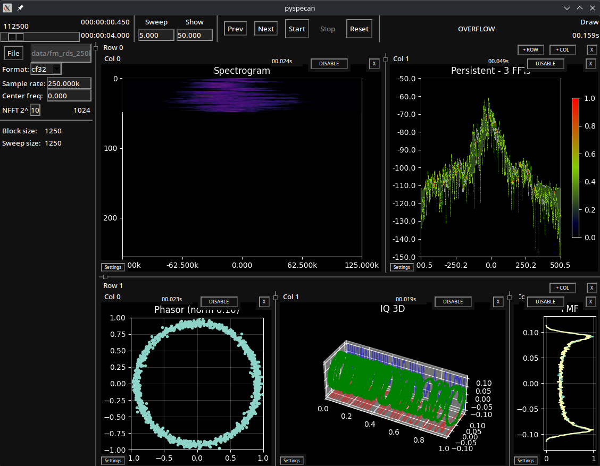

# pyspecan
 A spectrum analyzer library

 - [Documentation](https://anonoei.github.io/pyspecan/)
 - [PyPI](https://pypi.org/project/pyspecan/)

# Examples
tkGUI, PSD and spectrogram

tkGUI, persistence and realtime spectrogram

# Usage
- View (-v|--view): specifies which frontend to use (tkGUI, web, cui)
- Sink (-s|--sink): specifies which interface to use (file, live)
  - Live uses [pysdrlib](https://github.com/anonoei/pysdrlib) for hardware SDR abstractions

## Module
- `python3 -m pyspecan --help`
- tkGUI, file: `python3 -m pyspecan`
- tkGUI, live (hackrf): `python3 -m pyspecan -s live -d hackrf`
- web, file: `python3 -m pyspecan -v web -f <file> -d cf64 -fs 250k`, then open http://127.0.0.1:8000
- console, file: `python3 -m pyspecan -v cui -f <file> -d cf64 -fs 250k`, type `help` (draws plots as text, needs no plotting library)

# Install
1. Run `pip install pyspecan`, to install
2. Run `python3 -m pyspecan --help` to view available arguments

# Contributing
1. `git clone https://github.com/Anonoei/pyspecan`
2. `cd pyspecan`
3. `git branch -c feature/<your feature>`
4. `python3 builder.py -b -l` build and install locally

## Build executable
1. `pyinstaller src/pyspecan.spec`
2. `./dist/pyspecan`
