# Gallery

Taken by `python dev/screenshots.py` on a synthetic capture (QPSK with an echo, an FM carrier, a carrier with phase
noise, two tones and their IM3 products, a bursty signal, a chirp); run it again to refresh them (they are in
[media/](https://github.com/Anonoei/pyspecan/tree/main/media)).

Web: PSD with found signals and a peak marker (the cursor readout over it), spectrogram, persistence, surface spectrogram
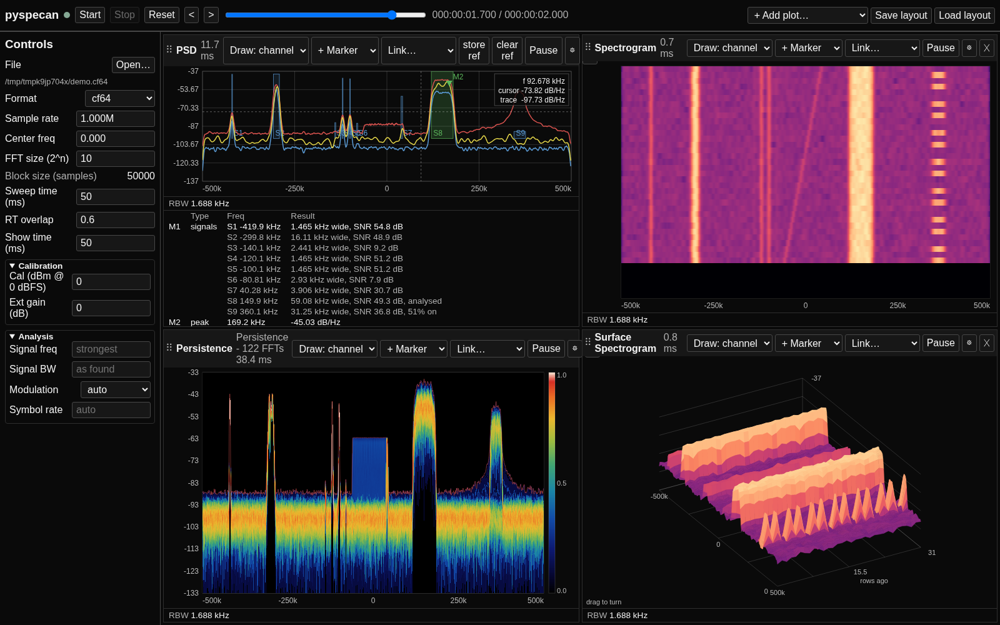

Web: channel power, TOI and a limit line, phase noise, FM demodulation, CCDF
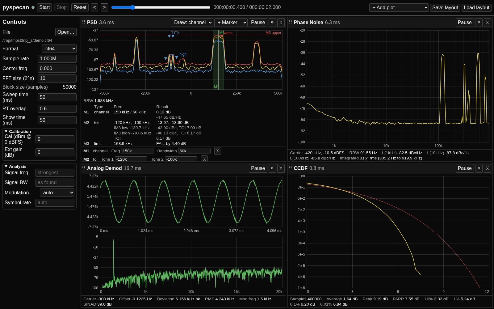

Web: 3D waterfall, IQ 3D, a turned surface spectrogram, occupancy
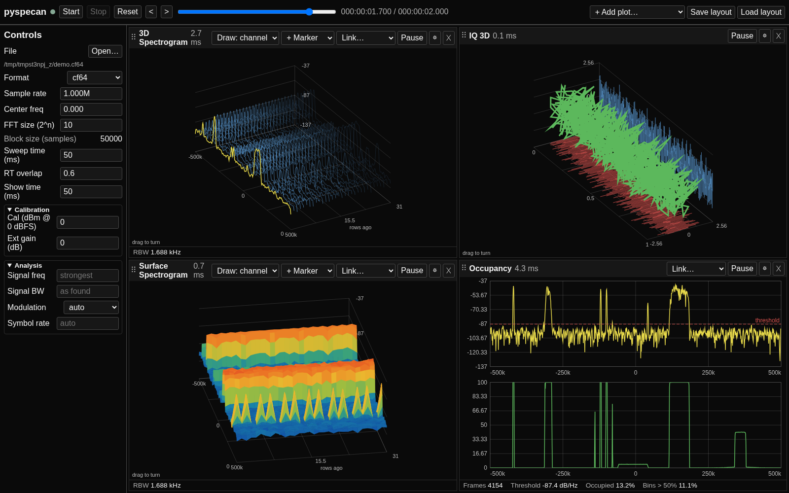

Web: a triggered scope, frequency vs time, IQ density, power vs time
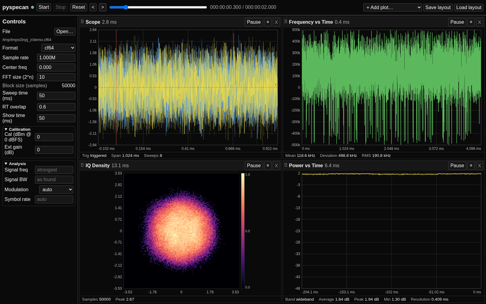

Web, with RPPS: the analysed signal's constellation, eye diagram and the link's response (network analyzer)
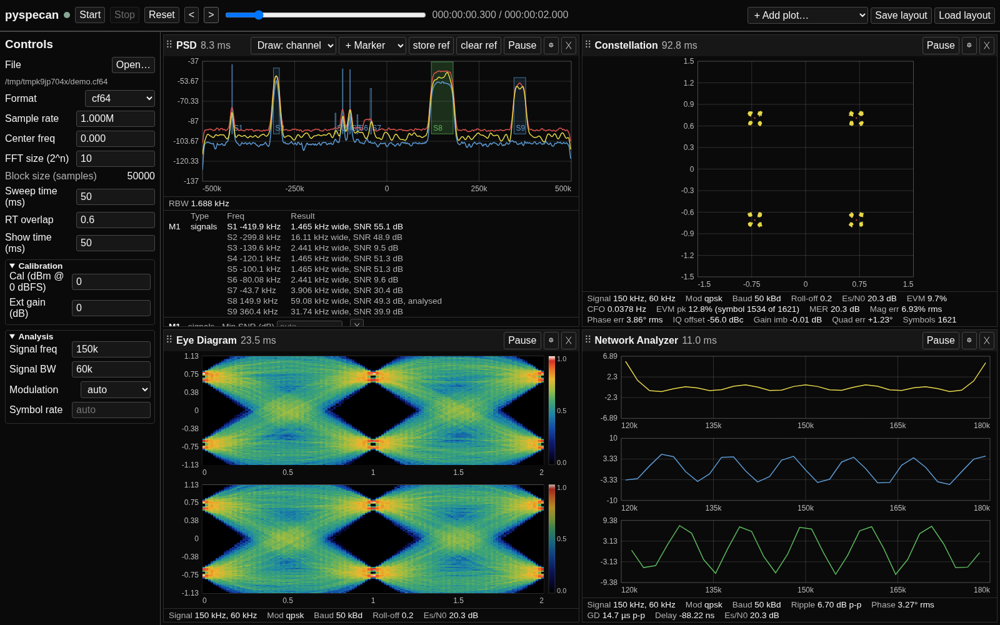

Web, with RPPS: 3D constellation, error vector, impulse response (the echo at 100 µs), cyclic spectrum
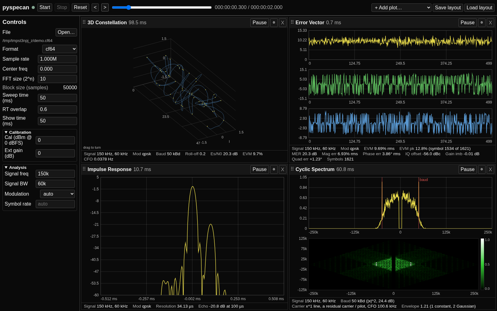

Web: a PSD against a stored reference (trace math: live - ref, the burst that has since stopped shows as a dip),
wavelet scalogram, and with RPPS the vector diagram and constellation density (the echo splits each point in four)
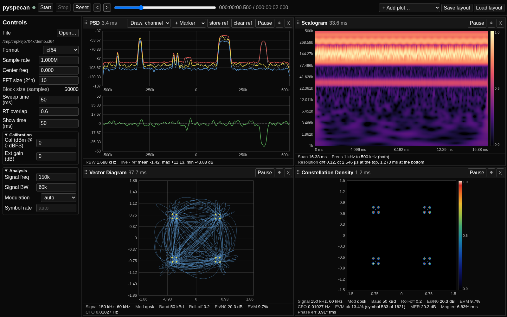

Web: the plot picker, a plot's tooltip saying what it shows, what to use it for and what it costs
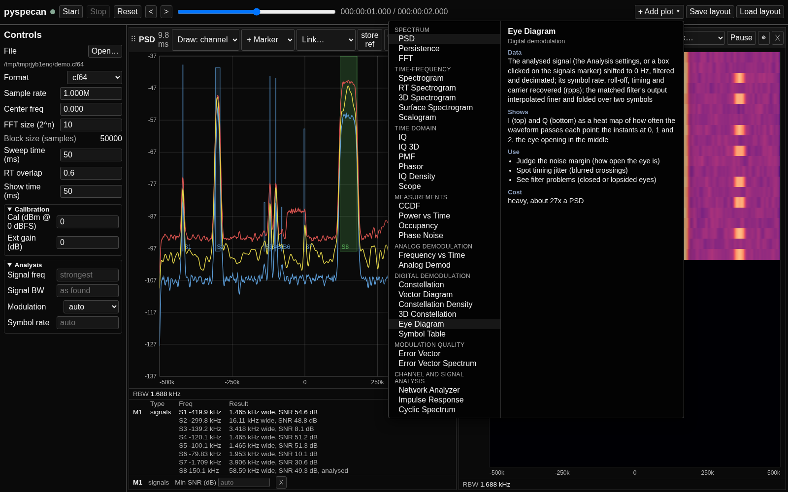

tkGUI: PSD with a peak marker and occupied bandwidth, spectrogram, persistence, 3D spectrogram
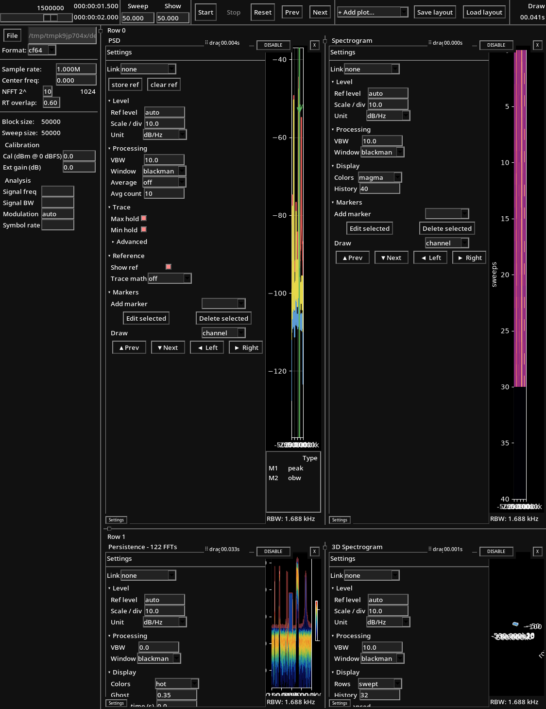

tkGUI, with RPPS: found signals, constellation, eye diagram, error vector
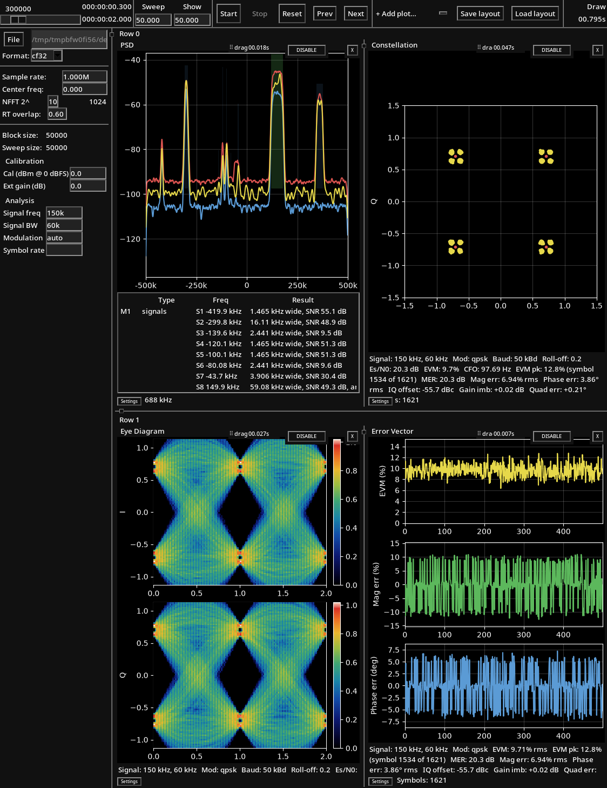

Console: PSD and spectrogram drawn as text
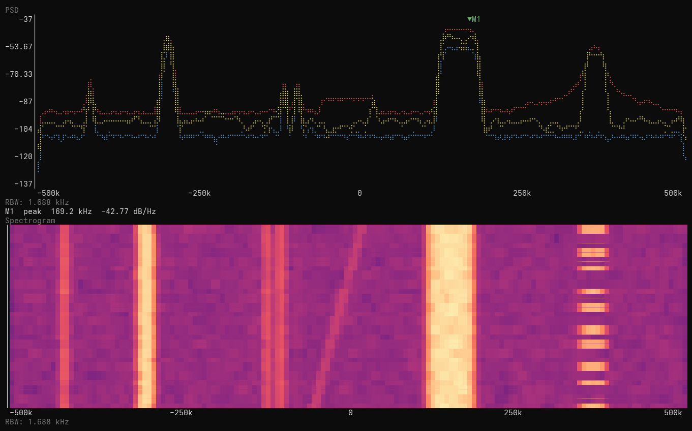
